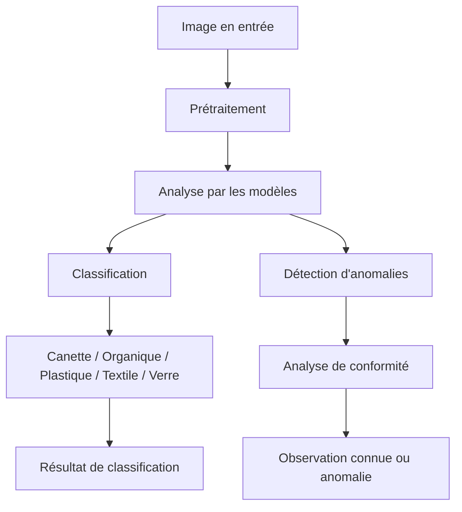

# Classification et détection d'anomalies de déchets


Système intelligent de reconnaissance et de détection d'objets inconnus dans le domaine de la gestion des déchets, fondé sur le Deep Learning et la vision par ordinateur.

---

## 📋 Table des matières

- [Présentation du projet](#-présentation-du-projet)
- [Problématique](#-problématique)
- [Catégories de déchets](#-catégories-de-déchets)
- [Architecture du système](#️-architecture-du-système)
- [Technologies utilisées](#-technologies-utilisées)
- [Installation](#-installation)
- [Structure du projet](#-structure-du-projet)
- [Utilisation](#-utilisation)
- [Configuration](#️-configuration)
- [Résultats attendus](#-résultats-attendus)
- [Perspectives](#-perspectives)
- [Contributions](#-contributions)
- [Licence](#-licence)

---

## 🎯 Présentation du projet

Ce projet développe un système intelligent de gestion des déchets fondé sur le **Deep Learning et la vision par ordinateur**. Il repose sur deux fonctionnalités complémentaires :

1. **Classification des déchets :** identifier automatiquement le type de déchet présent dans une image parmi cinq catégories prédéfinies.

2. **Détection d'anomalies :** identifier les images qui ne correspondent à aucune des catégories connues par le système. Ces observations peuvent représenter des objets inconnus, des déchets appartenant à de nouvelles catégories ou des éléments susceptibles de perturber le processus de tri.

L'association de ces deux fonctionnalités vise à améliorer la fiabilité du système face à la diversité des objets rencontrés dans un environnement réel.

## 🔍 Problématique

Dans un système conventionnel de classification d'images, un modèle attribue généralement une classe connue à chaque observation présentée, même lorsque celle-ci représente un objet absent de ses données d'entraînement.

Cette limitation constitue un problème important dans les applications réelles de gestion des déchets, où la diversité des objets peut dépasser les catégories initialement définies.

Le système cherche donc à répondre à trois enjeux :

- ♻️ **Classification :** reconnaître correctement les déchets appartenant aux catégories connues.
- 🔎 **Détection des inconnus :** identifier les observations qui ne correspondent à aucune catégorie apprise.
- 🌱 **Évolutivité :** faciliter la prise en compte de nouvelles catégories de déchets.

Pour répondre à ces enjeux, le projet combine un modèle de classification avec un **Variational Autoencoder (VAE) intégrant des blocs résiduels**.

Cette architecture vise à apprendre un espace latent structuré, exploitable pour la représentation des données et la détection des anomalies.

## 🗂️ Catégories de déchets

Le système de classification reconnaît cinq catégories :

| Catégorie | Description |
|---|---|
| Canette | Déchets métalliques de type canette |
| Organique | Déchets d'origine organique |
| Plastique | Objets et emballages en plastique |
| Textile | Déchets constitués de matières textiles |
| Verre | Objets et emballages en verre |

La détection d'anomalies intervient en complément de cette classification afin de signaler les images qui ne correspondent pas aux catégories apprises.

## 🏗️ Architecture du système

### Vue d'ensemble

Le système s'articule autour de deux composantes principales :

**1. Modèle de classification**

Chargé de reconnaître les cinq catégories de déchets connues à partir des images fournies en entrée.

**2. Modèle de détection d'anomalies**

Fondé sur un Variational Autoencoder (VAE) intégrant des blocs résiduels. Il apprend à représenter les observations appartenant au domaine connu afin de distinguer celles qui présentent des caractéristiques atypiques.

### Principe de fonctionnement

Le fonctionnement général du système peut être résumé en trois étapes :

1. **Acquisition :** réception d'une image contenant un objet ou un déchet.
2. **Analyse :** traitement de l'image par les modèles de classification et de détection d'anomalies.
3. **Décision :** identification de la catégorie lorsque l'observation appartient au domaine connu, ou signalement d'une anomalie lorsque celle-ci est considérée comme inconnue.

### Schéma conceptuel



*Ce schéma présente le principe fonctionnel général du système.*

## 🛠️ Technologies utilisées

Le projet repose principalement sur les technologies suivantes :

| Technologie | Utilisation |
|---|---|
| Python | Langage de programmation |
| TensorFlow | Développement et entraînement des modèles |
| Keras | Construction des architectures de Deep Learning |
| NumPy | Calcul numérique et manipulation des tableaux |
| Matplotlib | Visualisation des résultats |
| OpenCV | Traitement et manipulation des images |

Les bibliothèques effectivement utilisées dépendent des modules et des scripts présents dans le projet.

## 💻 Installation

### 1. Cloner le dépôt

```bash
git clone <URL_DU_DEPOT>
```

Accéder ensuite au répertoire du projet :

```bash
cd <NOM_DU_PROJET>
```

### 2. Créer un environnement virtuel

Il est recommandé d'utiliser un environnement virtuel afin d'isoler les dépendances du projet.

Sous Windows :

```bash
python -m venv venv
venv\Scripts\activate
```

Sous Linux et macOS :

```bash
python3 -m venv venv
source venv/bin/activate
```

### 3. Installer les dépendances

Si le dépôt contient un fichier `requirements.txt` :

```bash
pip install -r requirements.txt
```

Sinon, les principales bibliothèques peuvent être installées individuellement :

```bash
pip install tensorflow numpy matplotlib opencv-python scikit-learn
```

**Remarque :** la version de TensorFlow doit être compatible avec la version de Python et l'environnement matériel utilisés.

## 📁 Structure du projet

La structure suivante présente une organisation indicative des différents composants du projet. Elle doit être adaptée à l'arborescence réelle du dépôt.

```text
GestionsDechet/
│
├── data/
│   ├── train/
│   ├── test/
│   └── anomalies/
│
├── models/
│   ├── classification/
│   └── anomaly_detection/
│
├── notebooks/
│   └── experiments.ipynb
│
├── src/
│   ├── classification/
│   ├── anomaly_detection/
│   ├── preprocessing/
│   └── utils/
│
├── results/
│   ├── figures/
│   └── metrics/
│
├── requirements.txt
├── README.md
└── LICENSE
```

### Description des principaux répertoires

- `data/` : données utilisées pour l'entraînement, l'évaluation et les expériences de détection d'anomalies.
- `models/` : modèles entraînés et fichiers nécessaires à leur exploitation.
- `notebooks/` : notebooks consacrés aux expérimentations et aux analyses.
- `src/` : implémentation des différents composants du système.
- `results/` : résultats expérimentaux, métriques et visualisations.

## 🚀 Utilisation

L'utilisation du système repose sur les modèles entraînés et les modules de traitement des images.

### 1. Préparation des données

Organiser les images selon les catégories de classification définies :

```text
data/
├── train/
│   ├── Canette/
│   ├── Organique/
│   ├── Plastique/
│   ├── Textile/
│   └── Verre/
│
└── test/
    ├── Canette/
    ├── Organique/
    ├── Plastique/
    ├── Textile/
    └── Verre/
```

Les images destinées à l'évaluation des anomalies doivent également être organisées conformément au protocole expérimental retenu.

### 2. Entraînement des modèles

L'entraînement comporte deux volets :

- L'apprentissage du modèle de classification sur les catégories de déchets connues.
- L'apprentissage du VAE avec blocs résiduels pour la modélisation des observations appartenant au domaine connu.

Les scripts d'entraînement correspondants doivent être exécutés depuis leur emplacement dans le projet.

### 3. Évaluation

L'évaluation doit permettre d'étudier séparément :

- Les performances de classification sur les cinq catégories.
- La capacité du système à identifier les observations inconnues.
- La qualité de séparation entre les observations connues et les anomalies.

### 4. Prédiction sur une nouvelle image

Une nouvelle image peut être soumise au système pour obtenir une prédiction de catégorie et une indication relative à son caractère connu ou atypique.

Les commandes exactes d'exécution dépendent des scripts d'inférence disponibles dans le dépôt.

## ⚙️ Configuration

Les paramètres expérimentaux peuvent notamment concerner :

| Paramètre | Description |
|---|---|
| Taille des images | Dimensions des images en entrée |
| Nombre de classes | Cinq catégories de déchets |
| Taille des lots | Nombre d'images traitées par itération |
| Nombre d'époques | Durée de l'entraînement |
| Optimiseur | Algorithme d'optimisation |
| Fonction de perte | Fonction utilisée pour l'apprentissage |
| Seuil d'anomalie | Critère de décision entre observation connue et anomalie |

Les valeurs précises de ces paramètres doivent être définies dans les fichiers de configuration ou les scripts d'entraînement.

## 📊 Résultats attendus

Le système vise à produire deux types de résultats complémentaires.

### Classification

- Identification de la catégorie de déchet.
- Probabilités ou scores associés aux classes prédites.
- Évaluation des performances à l'aide de métriques de classification.

### Détection d'anomalies

- Identification des observations appartenant au domaine connu.
- Signalement des observations considérées comme atypiques.
- Analyse de la capacité du modèle à distinguer les données connues des données inconnues.

Les résultats expérimentaux, les matrices de confusion et les visualisations pourront être consultés dans le répertoire `results/`, lorsqu'ils sont disponibles.

## 🔭 Perspectives

Plusieurs axes peuvent être envisagés pour prolonger ce travail :

- Étendre le système à de nouvelles catégories de déchets.
- Améliorer la robustesse face aux variations des conditions d'acquisition des images.
- Étudier différentes stratégies de représentation dans l'espace latent.
- Évaluer la généralisation du système sur des données issues de nouveaux environnements.
- Explorer des mécanismes d'apprentissage permettant l'intégration progressive de nouvelles catégories.

## 🤝 Contributions

Les contributions visant à améliorer le projet sont les bienvenues.

Pour contribuer :

1. Forker le dépôt.
2. Créer une branche dédiée à la modification :

   ```bash
   git checkout -b feature/nouvelle-fonctionnalite
   ```

3. Effectuer les modifications souhaitées.
4. Soumettre une Pull Request en décrivant les changements apportés.

Les contributions peuvent concerner l'amélioration des modèles, le traitement des données, la détection d'anomalies, la documentation ou les expérimentations.

## 📄 Licence

Ce projet est distribué sous licence **MIT**.

Vous êtes libre de consulter, utiliser, modifier et redistribuer le code conformément aux conditions définies dans le fichier `LICENSE`.

---

**Développé dans le cadre de travaux sur le Deep Learning et la vision par ordinateur appliqués à la gestion des déchets.**